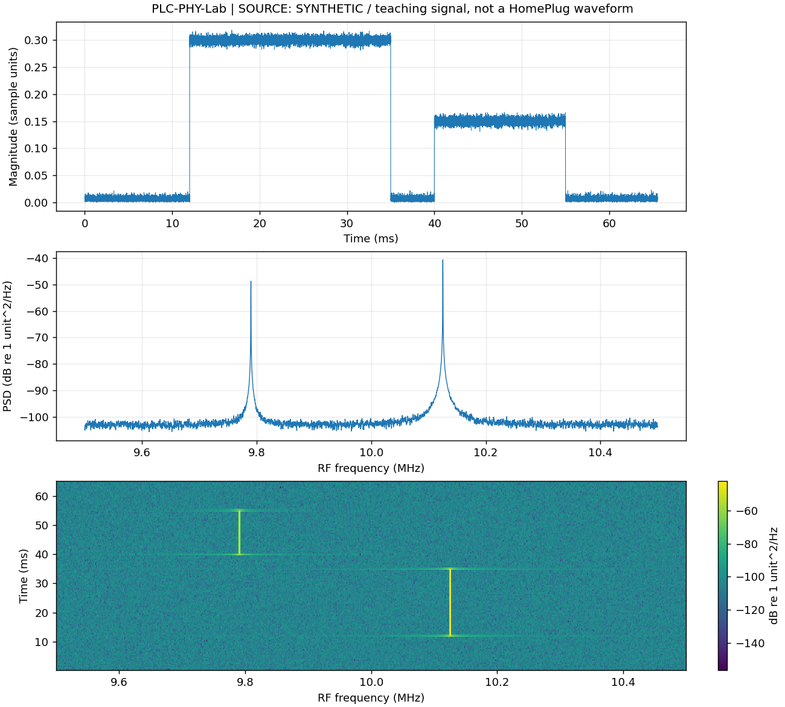

# PLC-PHY-Lab

**用真实电路、可复现测量与数字信号处理，学习充电桩 CP–PE 上的 HomePlug Green PHY。**

这是一个持续更新的个人学习与实验项目。现阶段使用 HackRF One、PLC 耦合器、限幅器和衰减器，逐步研究耦合前端、信道、噪声及 OFDM。它记录设备确认程度、实验设置、原始数据格式和结论的证据；当前功能包括分频段 GNU Radio 接收流程与离线 IQ 分析。

> 当前没有实现标准 HomePlug Green PHY 解码。示例图来自合成测试信号。此前硬件测试以“会话记录导入”保存，尚无可公开的原始 IQ 或完整控制台日志。

## 从这里开始

- [学习路线与完成条件](docs/LEARNING_PLAN.md)
- [现有设备与待确认参数](docs/INVENTORY.md)
- [测量链路与输入保护](docs/MEASUREMENT_CHAIN.md)
- [实验目录与状态](experiments/README.md)
- [学习日志](journal/2026-11-25.md)
- [日常记录与提交方法](docs/RECORDING_WORKFLOW.md)
- [参考项目与阅读入口](docs/REFERENCES.md)
- [BROKENWIRE：耦合与功率测量阅读笔记](docs/reading/BROKENWIRE.md)
- [Current Affairs：SLAC 与 PCAP 源码阅读](docs/reading/CURRENT_AFFAIRS.md)

## 当前进度

| 项目 | 状态 | 证据边界 |
| --- | --- | --- |
| Windows 识别 HackRF One，短时 GNU Radio 接收 | 会话记录导入 | 未归档原始输出，本仓库建立时未重复占用设备 |
| 频谱／瀑布界面观察 | 会话记录导入 | 当时 ANTENNA 仍盖防尘帽，不能据此认定接收到 PLC |
| 分频段频谱、定时 IQ 流程 | 已整理 | 源文件随仓库提供；编译检查见学习日志 |
| CP–PE 实际 IQ、绝对功率标定、PHY 解码 | 待实验 | 无实测结论 |
| 离线分析示例 | 合成数据 | 用于验证工具，不代表实际 PLC 波形 |

## 五分钟离线运行

需要 Python 3.10 或以上。离线工具不要求连接 SDR。

```powershell
python -m venv .venv
.\.venv\Scripts\python.exe -m pip install -r requirements.txt
.\.venv\Scripts\python.exe -m tools.generate_demo
.\.venv\Scripts\python.exe -m tools.analyze_iq data/raw/synthetic_demo.cf32 --metadata data/raw/synthetic_demo.metadata.json --output-dir data/processed/synthetic-demo
.\.venv\Scripts\python.exe -m unittest discover -s tests -v
.\.venv\Scripts\python.exe -m tools.check_project
```

已有 radioconda 时可直接使用其 Python，无需重复安装 GNU Radio。所有命令从项目根目录执行。



图中只展示已知频率的合成突发和噪声；纵轴未经射频功率标定。

## 接入 GNU Radio

打开 [频谱流程](sdr/gnuradio/homeplug_spectrum.grc) 或 [定时采集流程](sdr/gnuradio/homeplug_capture.grc)。使用 Soapy HackRF Source，默认 20 MS/s、模拟带宽显式设为 20 MHz、RF 放大关闭、IF/VGA 增益为 0。

- 10 MHz 中心频率：理论采样区间 0–20 MHz，初期重点观察 2–18 MHz。
- 22 MHz 中心频率：理论采样区间 12–32 MHz，初期重点观察 14–30 MHz。
- 一台 HackRF 的最高 20 MS/s 不能同时覆盖完整的 2–30 MHz；分时采样不能还原同一帧的全带宽波形。
- 同一时刻只让一个流程占用 HackRF。

详细操作见 [GNU Radio 使用说明](sdr/README.md)。接线前先核对 [测量链路](docs/MEASUREMENT_CHAIN.md)。

## 每次实验如何记录

```powershell
python -m tools.new_experiment --slug protected-subband-capture --title "保护链验证后的首次分频段采集"
```

命令建立带唯一编号的实验目录，并更新索引。实验笔记按“问题 → 参数 → 操作 → 数据 → 分析 → 结论 → 局限”填写。

测量数据只保留在本地 `data/raw/`；默认不提交 IQ。采集后用 `tools.capture_metadata` 创建元数据，再进行离线分析。操作示例与字段定义见 [数据格式](docs/DATA_FORMAT.md)。

## 贡献与许可

欢迎以 Issue 记录学习问题、实验复现和参数勘误。提交结论时注明实测、仿真或引用来源。项目代码和原创文档采用 [MIT License](LICENSE)；外部项目、数据表和标准仅链接引用，版权与许可归原作者。
